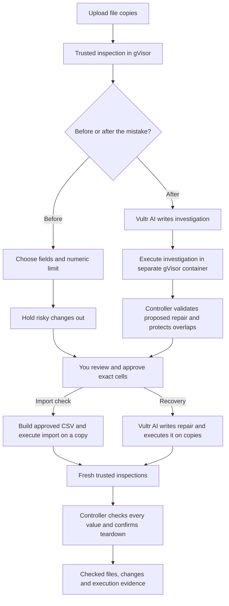

# Rewind

**Check the next import. Undo the bad one. Keep the good work.**

You meant to update prices. Your CSV also clears a field, resets a payment, or turns a $21 price into $2,100. Rewind helps you catch those changes before you import the file. If the mistake has already happened, it helps you restore the damaged cells while keeping the newer work.

You see the exact changes, decide which ones to approve, and download checked files after Rewind has run the update or repair on copies.

[Open Rewind](https://rewind-vultr-ckay.vercel.app) · [Watch the recovery walkthrough](https://rewind-vultr-ckay.vercel.app/demo/) · [Slides](https://rewind-vultr-ckay.vercel.app/demo/rewind-slides.pdf) · [Recovery execution checks](web/demo/live-evidence.json)

Open the app and choose **Check the next import** or **Undo a bad import**. There is no email sign-in. Your browser has private access to its own workspace.


## The problem

This is a problem [Shopify has already covered in its own documentation](https://help.shopify.com/en/manual/products/import-export/import-products). Once a product CSV import starts, you cannot cancel it. An included blank field can overwrite an existing value. Shopify tells merchants to back up their product data before importing.

Now imagine that happened to your business. The prices are wrong, but work keeps coming in. Someone records payments, adds new invoices and corrects a few prices manually. Yesterday’s backup has the good prices, but it does not have that newer work.

You need two things: a way to check the next import before it creates a problem, and a way to undo a specific mistake without rolling back everything else. That is what Rewind gives you.

It is built for the person responsible for bulk updates: a shop operator updating a catalog, a bookkeeper handling invoice exports, or an operations team moving records between systems. The first version works with small CSV exports and SQLite snapshots with reliable record IDs.

## Why would anyone pay for this?

Because the cost of a bad import is the work it creates afterward. Someone has to find the wrong values, work out which changes were legitimate, repair the file and check that nothing else broke. Incorrect prices can affect sales. Cleared fields can break a catalog. Reset payment statuses create reconciliation work.

If your team imports files regularly, that is a recurring problem. Before each upload, Rewind shows what the file would change, keeps unexpected edits out, and gives you an import containing only the updates you approved. You can check the next supplier price list or finance export through the same workflow instead of comparing every row by hand.

When something has already gone wrong, you can recover individual values and keep the payments, new records and later corrections your team has made. You get a checked copy and a clear change list to review with the person who owns the data.

The reason to pay is straightforward: less time checking routine imports, less cleanup after mistakes, and a reviewable record of what was approved. The most natural commercial model is a team subscription for recurring import checks and recovery. The public app is free to try; billing is not part of this release.

## Check an import before it runs

1. Choose **Check the next import**, then try the included example or upload today’s CSV export and the CSV you plan to import.
2. Confirm the unique record ID column. The import can contain a subset of the export’s fields.
3. Choose what this update is supposed to change. If you are updating prices, select the price field and set the largest numeric change you want to include.
4. Check the file. Rewind shows every proposed change and holds out blank overwrites, unintended fields, numeric changes above your limit and IDs absent from today’s export.
5. Deselect any other update you do not want. Review the exact cells and approve that plan.
6. Rewind builds the approved import, runs it against a disposable copy of your export, and checks both files in fresh isolated environments.
7. Download the **approved import**, the **resulting export**, the complete change list and the execution checks. Repeat this before the next import.

In the included price-update example, the file contains 22 ordinary price changes, one price multiplied by 100, one blank price, 24 unwanted payment-status changes and one unknown ID. With a 25% price-change limit, the approved update contains the 22 ordinary price changes. The other 26 cell changes and the unknown ID stay out; all 24 current records and their payment statuses stay intact.

The preview uses a clear rule: **update existing records by ID, and preserve fields omitted from the import**. It never adds or deletes records. The approved CSV includes only records with selected updates and only the ID plus selected fields. Where that rectangular CSV includes an unselected cell, it carries the value from today’s export; the checker verifies that it stays unchanged.

Use it with an import workflow that follows those rules. Recheck against a fresh export if operational data changes before you apply it. This is a check against the files you supplied; a direct Shopify connection is not included.

## Undo an import that has already gone wrong

1. Choose **Undo a bad import** and open the example or upload your versions.
2. Bring the last good version, a copy taken just after the mistake, and today’s file.
3. Describe what happened. Vultr AI writes diagnostic code that actually compares the versions in its own gVisor sandbox.
4. Review the proposed replacements beside the later edits that will stay. Each checkbox is one exact cell.
5. Approve the exact plan. Vultr AI writes the repair, which runs on disposable copies in another sandbox.
6. A fresh checker compares every resulting value with your approval and today’s file. Download opens after the data checks and removal of every temporary environment pass.

The recovery example starts with 120 damaged invoice prices. Your team then adds seven invoices, records twenty payments and edits three of the affected prices. Rewind restores **117 prices** while keeping **all 127 records, all twenty payment updates and all three later price edits**.

| What you do | New invoices kept | Payment updates kept | Later price edits kept |
| --- | ---: | ---: | ---: |
| Replace today’s file with the good backup | 0 | 0 | 0 |
| Restore every old price | 7 | 20 | 0 |
| Restore the exact Rewind plan | 7 | 20 | 3 |

The broad rollbacks are labelled reference comparisons. The integration checks actually execute them and reject the changes that violate the approved recovery.

You can also bring two versions and select damaged cells yourself. Without the copy taken just after the mistake, Rewind cannot identify later edits to the selected cells. New records and every cell outside approval still keep today’s values.

## How it protects the work you want to keep

For import checks, your chosen fields and numeric limit define which changes can be included. Held cells cannot be approved through the review endpoint. Approval binds both file fingerprints, your rules, every selected cell and the workspace version. Changing the rules or selection requires a fresh plan.

For recovery, the checkpoint is the copy taken just after the mistake. Rewind compares independently inspected values across all three versions:

| What the versions show | What Rewind does |
| --- | --- |
| The mistake changed a cell; today still has that damaged value | Proposes restoring the good value |
| The cell changed again afterward | Keeps today’s value and shows the overlap |
| Today already has the good value | Leaves it alone |
| A cell is outside approval, or a record exists only in today’s file | Keeps today’s value |

The recovery approval binds all supplied versions and the exact cells. Selecting two records and two fields does not automatically authorize four changes.

Snapshots show the differences you can observe. They do not prove a complete edit history. If a cell changed and later returned to its checkpoint value, the snapshots cannot reveal that. Reliable IDs and a correctly timed checkpoint matter.

Your originals stay unchanged. You download separate files and decide how to apply them. You can delete a completed workspace from the app to remove its uploads, plan and checks.

## What Vultr does here

Rewind is built for [Vultr Agent Rush, Challenge 1: Blast Radius Zero](https://lablab.build/ai-hackathons/vultr-hackathon). The useful part of the infrastructure is that code and uploaded files can be handled on copies, inside isolation, while the controller checks the result separately.

| Component | Its job | Code |
| --- | --- | --- |
| Vultr VM | Serves the app, schedules work, keeps uploaded copies, binds approvals and checks the results | [Controller](rewind/server.py) |
| Vultr Serverless Inference | Writes the investigation and approved recovery programs | [Provider](rewind/provider.py), [recovery pipeline](rewind/pipeline.py) |
| Docker with pinned gVisor | Parses uploaded files, executes programs and reads resulting files in separate disposable containers | [Sandbox](rewind/sandbox.py), [fixed worker](rewind/worker.py) |
| Import rules and independent checks | Hold unwanted changes out and verify the approved import and its executed result | [Import rules](rewind/preflight.py), [import pipeline](rewind/import_pipeline.py) |
| Recovery rules and independent checks | Restore approved cells and preserve every other current value | [Recovery contract](rewind/contract.py) |



The recovery model is Vultr’s `glm-5.3-flash`. It receives your description, file structure and aggregate change counts. File contents, extracted record values, record IDs, workspace capabilities and credentials are not automatically included in inference requests. The import preflight uses fixed checks and makes no model calls.

Generated programs are untrusted. The investigation can propose cells, but the controller validates them against trusted inspections. The repair cannot mark itself as passed. The checker derives expected values outside the repair container and reads the output in a fresh trusted container.

Every sandbox uses the pinned gVisor runtime and Python image, no network, read-only inputs, a read-only root filesystem, a nonroot user and enforced execution bounds. Controller credentials and the Docker socket stay outside. There is no host or runc fallback.

The app checks every approved value, every protected value, the file structure, record set, record order where relevant, isolation and container removal. It also checks the downloaded artifact’s SHA-256. A missing or failed check blocks download.

Recovery uses at most two model calls per workspace. An investigation uses one and leaves one for repair; manual recovery can use up to two repair attempts. Failed provider attempts count. Restarting the controller does not silently retry a model request.

The public Vercel address forwards the app to the Vultr VM. Uploaded-file parsing, import execution, AI orchestration and independent verification run on Vultr. You can also reach the [Vultr backend health endpoint](https://rewind.139.84.249.47.sslip.io/__web/api/health).

## Files you can use

| Workflow | Requirements |
| --- | --- |
| Import check | Two UTF-8 CSV files, one shared nonempty unique ID column, incoming headers present in today’s export; existing-record updates only |
| CSV recovery | UTF-8 CSV versions with matching unique headers and the same nonempty unique ID column |
| SQLite recovery | Consistent snapshots of one ordinary user table, matching schema, one non-null integer or text primary key |
| All workflows | Up to 256 KiB per file, 1–1,000 records, 2–16 fields; up to 1,000 exact approved cells within the bounded execution scope |

CSV values stay literal: leading zeros, decimal formatting, Unicode, whitespace, quoted commas, newlines and empty fields are preserved exactly. Rewind does not evaluate spreadsheet formulas. Numeric guards accept plain decimal numbers; unsupported numeric formats stay held until you revise the file or change your chosen rules.

The first version works on exported copies. It does not write to production systems, parse arbitrary Excel workbooks or provide a full edit-history feed. SQLite views, triggers, virtual/generated tables or columns, multiple user tables, blobs and WAL-only database files are unsupported. Recovery keeps today’s record set, including observed deletions.

## Run it yourself

Use Python 3.12 or newer, an existing Docker daemon and the pinned gVisor runtime.

```sh
sudo bash infra/install-gvisor.sh
cp .env.example .env
```

Put your Vultr Inference key in the private environment file. Load it through your shell or service manager, then start Rewind:

```sh
python3 -m rewind.server
```

Open `http://127.0.0.1:18182`. Set `REWIND_ORIGIN` to the exact browser origin. A new private installation uses an access code; set `REWIND_PUBLIC_DEMO=1` to open it without that shared code. Each workspace still requires its own private capability. The preflight can run when isolation is ready even if Inference has not been configured.

To run the checks:

```sh
python3 -m unittest discover -s tests -v
python3 scripts/check-isolation.py
npm ci --no-audit --no-fund
node --check web/app.js
node --check web/preflight.js
node scripts/browser-check.mjs --plan-only
node scripts/import-browser-check.mjs
```

The unit checks cover exact approval, stale plans, held changes, decimal boundaries, protected values, model-call accounting, inference privacy and denied downloads. The integration checks execute real gVisor runs for CSV and SQLite recovery, reject broad rollbacks, test import previews and probe containment. Fixed reference checks make no model calls.

For one genuine diagnosis-and-recovery run against a configured deployment:

```sh
REWIND_TEST_URL=https://your-rewind-host \
REWIND_REPORT_DIR=/private/path/to/verification \
node scripts/browser-check.mjs --live --record
```

That starts two Vultr model calls. Private installations can supply `REWIND_ACCESS_FILE`. Capabilities, raw input files and recordings stay in ignored local folders.

## Deploy it

Build a reviewed release with `python3 scripts/build-release.py`. Copy the archive to your VM, check its SHA-256, and unpack it into a private staging directory.

```sh
sudo python3 -m rewind.deploy \
  --hostname rewind-backend.example.com \
  --public-origin https://rewind-vultr-ckay.vercel.app \
  --provider-env /etc/reprolab/reprolab.env \
  --caddy-config /etc/caddy/reprolab.Caddyfile \
  --caddy-service reprolab-https.service \
  --public-demo
```

Use the provider and proxy paths you inspected on your own VM. The installer verifies the release and preserves unrelated services and routes. It refuses to replace Rewind while one of its operations is active.

For a public gateway, `scripts/build-web-gateway.py` takes a clean commit, the public `--origin`, an HTTPS `--upstream` and a fresh `--output` directory. It packages presentation assets and a source ZIP and forwards app requests to the Vultr backend.

## See what actually ran

The [recovery evidence](web/demo/live-evidence.json) records the genuine Vultr investigation and repair, approval, input/output fingerprints, independent checks and confirmed teardown. The walkthrough shows that recovery and an actual containment test on Vultr.

The example files contain sample records. The checks are controller-observed execution evidence; they are not a security audit or hardware attestation. [THIRD_PARTY.md](THIRD_PARTY.md) explains the MIT-licensed ReproLab components used here.
