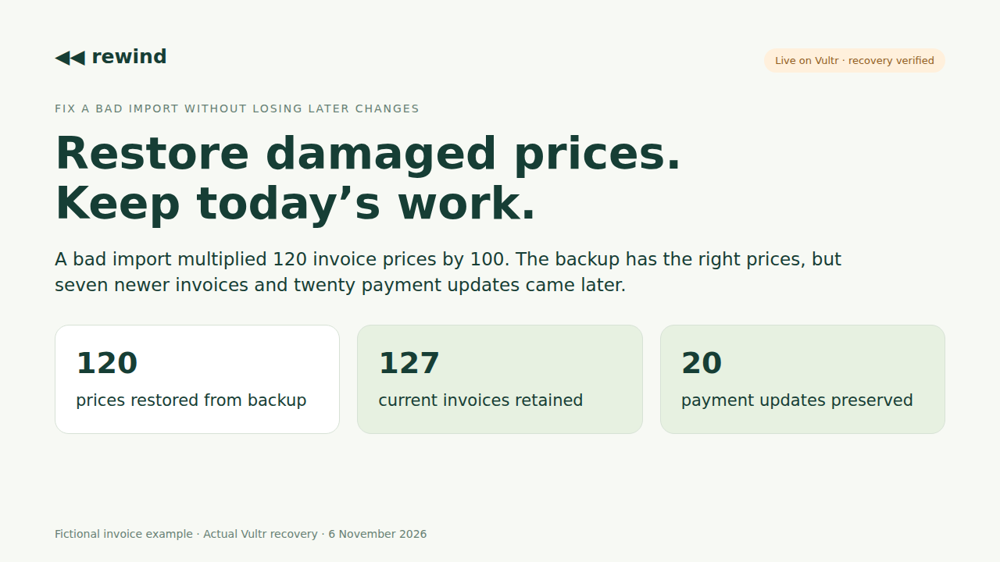
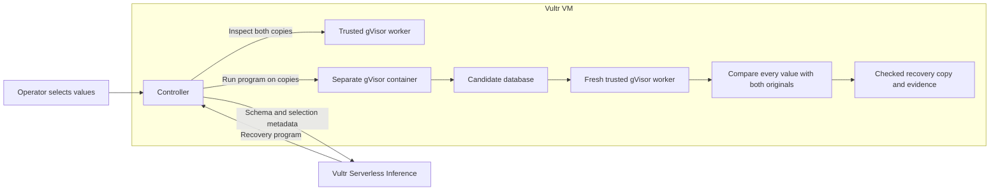

# Rewind

**Fix a bad database import. Keep the work that came after it.**

Rewind helps you restore damaged prices or other database values from a good backup while keeping newer records and updates. Upload two database copies, choose the values to restore, review the plan, and download a checked recovery copy.

For example, an import multiplies 120 invoice prices by 100. Since the backup, your team has added seven invoices and marked twenty invoices paid. Rewind restores the 120 prices and keeps all 127 invoices and the twenty payment updates. That recovery has been run and checked on Vultr.

[Open Rewind](https://rewind.139.84.249.47.sslip.io) · [Watch the narrated demo](https://rewind-vultr-ckay.vercel.app/demo/) · [Slides](https://rewind-vultr-ckay.vercel.app/demo/rewind-slides.pdf) · [Recovery evidence](web/demo/live-evidence.json)



## The problem

A small team running a billing or inventory app can have a usable backup and still face a difficult recovery. The old copy has the correct values. Today's copy has newer orders, payments and other work the team needs to keep.

Rewind makes that choice visible. You select damaged fields and records, see their old and current values, and approve only those replacements. It is built first for an app operator working with small SQLite snapshots after a bad import or bulk update.

| In the demonstrated invoice example | Invoices kept | Newer invoices kept | Later payment updates kept |
| --- | --- | --- | --- |
| Replace today's database with the whole backup | 120 | 0 | 0 |
| Rewind's checked recovery | 127 | 7 | 20 |

The model writes the recovery program for the selected table and fields. A separate checker compares its output with both originals, including every value outside the selection. A program that restores the right prices but loses newer work fails the check.

## Use it

1. Upload the last good SQLite snapshot and today's snapshot, or open the fictional invoice example.
2. Select the damaged columns and records. Rewind shows the values that would be restored.
3. Review the plan, including newer records and other changes that will stay.
4. Approve the recovery. Vultr Serverless Inference writes a recovery attempt, which runs on temporary copies.
5. Download the recovered database after independent checks and sandbox removal pass. The checks can be downloaded too.

The downloaded file is a recovery copy. Connecting it to your application is a separate operator decision. You can inspect snapshots and review a plan before connecting a model; starting the recovery requires configured Vultr Inference.

Select only damaged cells. If a selected cell also contains a newer legitimate edit, that edit would be replaced. You decide which cells to restore.

## Why Vultr is part of the work

Rewind was built for [Vultr Agent Rush, Challenge 1: Blast Radius Zero](https://lablab.ai/ai-hackathons/vultr-hackathon). The challenge calls for a web app on Vultr that plans a task, runs code in an isolated environment and returns verifiable output. Rewind applies that workflow to a database recovery people can inspect before using it.

| Technology | What it does here | Implementation |
| --- | --- | --- |
| Vultr VM | Serves the working app, holds the temporary database copies, schedules workers and checks the result | [Controller](rewind/server.py), [recovery pipeline](rewind/pipeline.py), [deployment](rewind/deploy.py) |
| Vultr Serverless Inference | Writes a recovery program for the table structure and the operator's selection | [Provider integration](rewind/provider.py) |
| Docker with gVisor | Inspects uploaded SQLite files and executes the generated program in separate, temporary containers | [Sandbox runner](rewind/sandbox.py), [trusted worker](rewind/worker.py) |
| Independent data checks | Accepts only the selected replacements while preserving today's other values and records | [Recovery checks](rewind/contract.py) |

The live recovery used Vultr's `glm-5.3-flash` model. It receives table and column names, declared types, selected column names, and the selected record count. Database files, row values, selected primary-key values, access codes, and credentials stay on the controller and its copies.



All uploaded SQLite inspection runs in fixed trusted gVisor workers. The generated recovery program runs in a separate gVisor container. A fresh trusted container reads the candidate output, and the controller compares it with the original snapshots. The generated program never receives the acceptance checks.

A result must preserve the schema, current primary keys, automatic ID sequences, newer records, and every unselected cell. Every selected replacement must exactly match its backup value. A failed candidate can receive one correction attempt. Provider or network failures stop the recovery.

Sandboxes use the complete checksum-pinned gVisor bundle and digest-pinned Python image. They run without network access, as user 65532, with read-only inputs and root filesystem, 192 MiB RAM, half a CPU, 48 PIDs, an eight-second deadline, bounded output, and no controller credentials. Download requires verified output, confirmed removal of every sandbox, and a fresh artifact fingerprint check.

The controller processes one job at a time, has a four-place queue, allows twelve uploads and four recoveries per day by default, and stores at most 32 workspaces. Workspace reads and downloads require a private capability. A restart fails interrupted jobs instead of silently restarting a model request.

## First-version scope

Use two consistent SQLite snapshots, each up to 256 KiB, with the same ordinary table and schema. The table needs one non-null integer or text primary key, 2–16 ordinary columns, and at most 1,000 rows. Use SQLite's Online Backup API when taking a live database copy; a WAL database file alone is rejected.

Virtual tables, views, triggers, generated columns, blobs, multiple user tables, and oversized values are unsupported. This prototype has no production database connection, automatic retention policy, or workspace deletion screen. Keep test files private and remove stored workspaces as an operator after use.

## Run locally

Python 3.12 or newer, an existing Docker daemon, and the pinned gVisor runtime are required. Runtime setup reloads Docker and verifies that its defaults and existing containers stay intact.

```sh
sudo bash infra/install-gvisor.sh
cp .env.example .env
```

Add your Vultr Inference key and a private demo access code to `.env`. Load that file through your service manager or shell, then run:

```sh
python3 -m rewind.server
```

The default address is `http://127.0.0.1:18182`. Set `REWIND_ORIGIN` to the exact browser origin when using a port forward or public hostname. Keep `.env` private.

## Verify

```sh
python3 -m unittest discover -s tests -v
python3 scripts/check-isolation.py
npm ci --no-audit --no-fund
node --check web/app.js
node scripts/browser-check.mjs
node scripts/browser-check.mjs --plan-only
```

The isolation check uses explicitly labelled reference programs. It verifies selective recovery, rejects whole-backup replacement, probes containment and limits, and confirms teardown. The `--plan-only` browser check inspects the fictional snapshots and verifies the selected recovery plan. These checks make no model calls.

With a configured live deployment, put its private code in an ignored local file and run the actual browser recovery once:

```sh
REWIND_TEST_URL=https://your-rewind-host \
REWIND_ACCESS_FILE=/private/path/to/access-code.txt \
node scripts/browser-check.mjs --live --record
```

This requests a real Vultr recovery. The recorder never starts an automatic second job. The resulting evidence, artifact, screenshots and video stay in ignored `reports/`.

## Deploy beside ReproLab

Build a release with `python3 scripts/build-release.py`. Copy the archive to the Vultr VM, verify its reported SHA-256, and unpack it into a private staging directory. The installer supports an existing ReproLab Caddy service and a new hostname such as `rewind.139.84.249.47.sslip.io`:

```sh
sudo python3 -m rewind.deploy \
  --hostname rewind.139.84.249.47.sslip.io \
  --provider-env /etc/reprolab/reprolab.env \
  --caddy-config /etc/caddy/reprolab.Caddyfile \
  --caddy-service reprolab-https.service
```

Inspect the actual provider environment path and Caddy service on your VM first. The installer preserves the existing proxy configuration and adds only Rewind's route. It creates a separate service, state directory, private reviewer code and sandbox cleanup timer. It reloads the proxy and starts only Rewind. Conflicting files, users, runtimes or routes stop installation.

## What has been demonstrated

The [video](https://rewind-vultr-ckay.vercel.app/demo/) shows the working app with fictional invoices and one genuine Vultr model request. The recovered file passed six independent data checks: database integrity, unchanged schema, retained records, unchanged ID counters, correct restored values and preserved unselected values. All five temporary worker containers were removed. The downloaded database's SHA-256 matched the checked artifact.

| Observed result | Evidence |
| --- | --- |
| 120 prices restored; all 127 invoices, seven newer invoices and twenty payment updates kept | [Complete live recovery evidence](web/demo/live-evidence.json) |
| A fixed program that runs forever stopped at the two-second test deadline; its container was removed | [Vultr containment checks](web/demo/containment-checks.json) |
| Network access and writes to inputs blocked; controller credentials and Docker socket unavailable; output limit enforced | [Vultr containment checks](web/demo/containment-checks.json) |
| Whole-backup replacement rejected; a selective reference recovery accepted; all ten test containers removed | [Vultr containment checks](web/demo/containment-checks.json) |
| Twenty-three unit tests, actual browser selection and live recovery checks passed | [Tests](tests/), [browser verifier](scripts/browser-check.mjs) |

The final video segment shows the recorded result of the separate containment test. Those fixed probes make no model requests. The recording details distinguish the original recovery footage, narration and containment segment. These are prototype checks and containment evidence, not a security audit.

See [THIRD_PARTY.md](THIRD_PARTY.md) for the MIT-licensed ReproLab components used here.
