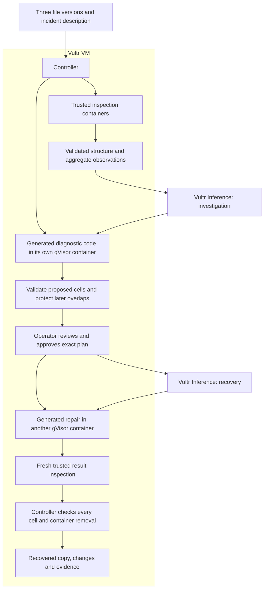

# Rewind

**Undo that bad import. Keep everything we changed since.**

A shop owner imports the wrong prices. Business continues: new records arrive, payments are recorded, and someone manually corrects a few prices. Restoring yesterday’s backup would fix the prices while erasing that later work.

Rewind investigates the mistake in ordinary CSV exports or SQLite snapshots, proposes individual cells to restore, and protects changes observed afterward. You review the exact repair, approve it, and download a separately checked copy. The original files stay unchanged.

[Open Rewind](https://rewind-vultr-ckay.vercel.app) · [Watch the walkthrough](https://rewind-vultr-ckay.vercel.app/demo/) · [Slides](https://rewind-vultr-ckay.vercel.app/demo/rewind-slides.pdf) · [Execution evidence](web/demo/live-evidence.json)

The public app opens directly. No account, email or shared code is required. Each browser has private access to its own workspace.


## The problem, grounded in a real workflow

[Shopify’s product-import documentation](https://help.shopify.com/en/manual/products/import-export/import-products) explains that a CSV import cannot be canceled once it begins, that an included blank field can overwrite an existing value, and that merchants should back up their product data before importing.

That creates a practical recovery problem: the good backup is old, while today’s file includes work worth keeping. Rewind is built for small shop operators, bookkeepers and organizers working with exported records. It makes selective recovery reviewable without asking them to write repair scripts.

The example uses 120 invoice prices damaged by an import. Afterward, seven invoices are added, twenty payment statuses change, and three affected prices are manually edited. The proposed repair restores **117 prices** while retaining **all 127 records, the twenty payment updates and the three later price edits**.

| Recovery approach in the example | Records retained | New records retained | Payment updates kept | Later price edits kept |
| --- | ---: | ---: | ---: | ---: |
| Replace today’s file with the good backup | 120 | 0 | 0 | 0 |
| Restore every old price blindly | 127 | 7 | 20 | 0 |
| Rewind’s precise repair | 127 | 7 | 20 | 3 |

The two broad rollback approaches are fixed reference comparisons. The independent checker rejects them when they violate the approved repair.

## Try it

1. Open the bad-import example, or upload your files.
2. Use the last good version, a copy taken immediately after the mistake, and today’s version. For CSV, identify the column containing a stable, unique record ID.
3. Describe the mistake. Vultr AI writes diagnostic code, which actually reads and compares the three versions in its own gVisor sandbox.
4. Review the proposed replacements beside the overlapping later edits that will stay. Select individual cells and inspect the complete plan.
5. Approve that exact plan. Vultr AI writes the recovery, which runs on disposable copies in another sandbox.
6. Browse every checked change and protected overlap, then download the recovered file, a complete CSV change list and execution checks after independent verification and container removal pass.

You can also use two versions and choose the damaged cells yourself. Without the after-incident checkpoint, Rewind cannot identify later edits to those selected cells. New records and every unapproved cell still keep today’s values.

The download is a recovery copy. Applying it to an operational system remains the operator’s decision. A completed workspace can be deleted from the app, removing its uploaded files, plan and checks.

## How later edits are protected

The checkpoint is the version immediately after the mistake. The controller compares trusted inspections of all three files.

| Observed cell values | Action |
| --- | --- |
| Good differs from checkpoint; today still equals checkpoint | Propose restoring the good value |
| Good differs from checkpoint; today differs from both | Keep today’s value and show a protected overlap |
| Today already equals the good value | Leave it alone; it is already restored |
| Cell is outside the exact approval, or record exists only in today’s file | Preserve today’s value |

Approval binds all input fingerprints, the exact cell mask, the diagnostic proposal when present, and the workspace version. A changed selection requires new review. Execution scope is a list of individual key-and-column pairs; selecting two fields and two records never implicitly authorizes all four cells.

Snapshots prove observed differences, not a complete edit history or authenticated provenance. An intervening edit that returns a cell to the checkpoint value cannot be inferred. Reliable record IDs and the timing of the supplied checkpoint matter.

## Why Vultr is essential to the workflow

Rewind is built for [Vultr Agent Rush, Challenge 1: Blast Radius Zero](https://lablab.build/ai-hackathons/vultr-hackathon): plan a real task, execute it inside isolation on Vultr, and return a verifiable result.

| Infrastructure | Work it performs | Implementation |
| --- | --- | --- |
| Vultr VM | Serves the application, holds copies, schedules bounded jobs, validates proposals and checks every resulting value | [Controller](rewind/server.py), [pipeline](rewind/pipeline.py) |
| Vultr Serverless Inference | Writes an investigation from the incident description and aggregate observations, then writes the approved recovery | [Provider](rewind/provider.py) |
| Docker with gVisor | Parses uploads, executes diagnostic code, runs recovery code and independently reads the result in separate containers | [Sandbox](rewind/sandbox.py), [trusted worker](rewind/worker.py) |
| Controller acceptance rules | Protect observed overlaps, bind exact approval and reject changes outside it | [Repair contract](rewind/contract.py) |



The model uses Vultr’s `glm-5.3-flash`. It receives your incident description, file format, table/field names and types, and validated aggregate counts. Recovery requests contain structural selection metadata and counts. Snapshot contents, extracted row values and record IDs, workspace capabilities and credentials are not automatically included in inference requests.

Generated diagnostics are untrusted proposals. The controller validates each proposed cell against the trusted snapshots and derives the protection rules itself. Generated recovery code does not receive the acceptance answers. A fresh fixed worker inspects its output; acceptance runs outside generated execution.

There are at most **two model calls per workspace**: one investigation plus one recovery, or up to two recovery attempts in manual mode. A failed diagnostic can leave one manual recovery call. Provider failures consume their attempted call; restarts never silently retry interrupted operations.

Every sandbox uses the complete checksum-pinned gVisor runtime and digest-pinned Python image, no network, read-only inputs and root filesystem, UID 65532, 192 MiB RAM, half a CPU, 48 PIDs, a 16 MiB temporary filesystem and an eight-second execution deadline. Input and output are bounded. No controller credentials or Docker socket enter the sandbox. There is no host or runc fallback.

Downloads require the complete successful data-check set, verified isolation and removal for every run, and a fresh match against the artifact’s SHA-256. The controller uses one worker and a bounded four-place admission queue. There is no daily trial or fixed workspace-count quota.

The public Vercel address forwards the deployed web application to the Vultr VM. Uploaded-file parsing, model orchestration, generated-code execution and independent verification all run on Vultr. The [Vultr backend health endpoint](https://rewind.139.84.249.47.sslip.io/__web/api/health) is directly reachable. Presentation assets and a clean source ZIP are also served directly at the public address.

## Supported files

| Format | Requirements |
| --- | --- |
| CSV | UTF-8, comma-separated, matching unique headers, one user-confirmed nonempty unique ID column, values up to 512 characters |
| SQLite | Consistent snapshots, one ordinary user table, matching schema, one non-null integer or text primary key, no WAL-only file |
| Both | 256 KiB per version, 1–1,000 records, 2–16 fields, up to 1,000 approved changed cells within a 112 KiB execution scope |

CSV cells remain literal strings: leading zeros, decimal formatting, Unicode, whitespace, quoted commas, newlines and empty fields are checked exactly. Records keep today’s order. Formulas are not evaluated.

This build repairs exported copies; it has no direct Shopify connection or support for arbitrary Excel workbooks. SQLite views, triggers, virtual/generated tables or columns, multiple user tables, blobs and oversized values are unsupported. It preserves today’s record set, including observed deletions, rather than recreating missing records. Automatic retention and full audit-history ingestion are future work; users can delete completed workspaces.

## Run and verify

Python 3.12 or newer, an existing Docker daemon, and the pinned gVisor runtime are required.

```sh
sudo bash infra/install-gvisor.sh
cp .env.example .env
```

Add your Vultr Inference key to the private environment file. Load it through your service manager or shell, then run:

```sh
python3 -m rewind.server
```

The default address is `http://127.0.0.1:18182`. Set `REWIND_ORIGIN` to the exact browser origin. New installations default to a private access code; `REWIND_PUBLIC_DEMO=1` opens the worker without a shared code. Workspace capabilities and execution bounds still apply.

```sh
python3 -m unittest discover -s tests -v
python3 scripts/check-isolation.py
npm ci --no-audit --no-fund
node --check web/app.js
node scripts/browser-check.mjs --plan-only
```

Unit tests cover exact cell authority, overlaps, missing checkpoints, stable CSV representations, stale approvals, model accounting, inference privacy, failed cleanup and denied downloads. Actual gVisor integration checks both formats, runs a diagnostic reference, restores 117 cells while protecting three overlaps, rejects broad rollbacks, rejects malformed CSV, probes containment and confirms all 38 test containers were removed. Fixed reference tests make no model calls.

With a configured live deployment:

```sh
REWIND_TEST_URL=https://your-rewind-host \
REWIND_REPORT_DIR=/private/path/to/verification \
node scripts/browser-check.mjs --live --record
```

This runs one genuine diagnosis-and-recovery sequence with two Vultr calls. Private installations can also supply `REWIND_ACCESS_FILE`. The recorder never mocks an API, switches providers or starts an automatic extra job. Reports, capabilities, downloaded inputs and raw recordings remain in ignored local folders.

## Deploy

Build a reviewed release with `python3 scripts/build-release.py`, copy its archive to the VM, verify the reported SHA-256 and unpack it into a private staging directory.

```sh
sudo python3 -m rewind.deploy \
  --hostname rewind-backend.example.com \
  --public-origin https://rewind-vultr-ckay.vercel.app \
  --provider-env /etc/reprolab/reprolab.env \
  --caddy-config /etc/caddy/reprolab.Caddyfile \
  --caddy-service reprolab-https.service \
  --public-demo
```

Use the actual inspected provider and proxy paths on your VM. The installer verifies the release, preserves unrelated services and routes, uses Rewind’s own service/state/cleanup timer, and refuses to replace the current release while a Rewind operation is active.

For the public gateway, `scripts/build-web-gateway.py` takes a clean commit, public `--origin`, HTTPS `--upstream`, and fresh `--output` directory. It includes presentation assets and the source ZIP, while forwarding application routes to the backend’s `/__web/` route.

## Evidence

The public walkthrough and evidence files document executed runs, input/output fingerprints, the precise approval, independent checks and confirmed teardown. The example records are sample inputs, not customer records. The containment segment shows an actual bounded test on Vultr, separate from the live model sequence.

These are controller-observed verification and containment checks, not a security audit or hardware attestation. See [THIRD_PARTY.md](THIRD_PARTY.md) for the MIT-licensed ReproLab components used here.
